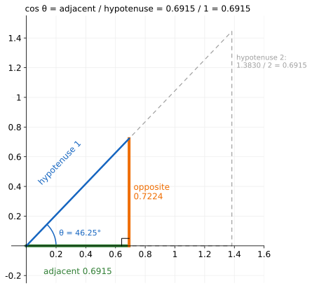
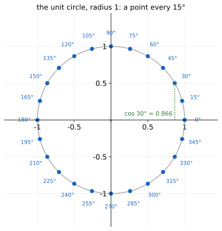
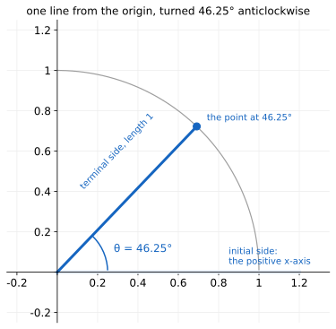

# The Unit Circle

Up: [[Trigonometry]] · [[Polar Coordinates]] ➡️

Mathematics, Trigonometry. Needs: dividing two decimals, and the [theorem of Pythagoras](../references/textbooks/geometry/geometry-handbook.pdf#page=80), $a^2 + b^2 = c^2$ on a right triangle.

**The cosine of an angle is how far right of the centre a point at that angle sits on a circle of radius 1.**

> [!question]- Test yourself
> No quiz page covers this note yet.

> [!warning]- Unfinished
> - No quiz page for this note yet.

Stated claims: 0.

**The toy angle.** Every number here is worked at one angle, 46.25°, the angle of post 51 in [[The Quarter Circle Under The Cosine Schedule]].

**Colours, the same in every equation and figure.** <span style="color:#2e7d32">**Green is $\cos\theta$, the horizontal leg**</span>, <span style="color:#ef6c00">**orange is $\sin\theta$, the vertical leg**</span>, <span style="color:#1565c0">**blue is the point, the line from the origin and its angle**</span>, and <span style="color:#757575">**grey is a case drawn for comparison or a piece removed**</span>. The cosine schedule notes this one feeds use the same four.

## Table of contents

- [[#The cosine on the unit circle]]
- [[#When to reach for the unit circle]]
- [[#The circle of radius 1]]
- [[#Polar coordinates]]
- [[#Try the unit circle yourself]]
- [[#How the unit circle works]]
- [[#Other ways to get a cosine]]
- [[#Why the unit circle matters]]
- [[#The unit circle taught in, applied in]]

## The cosine on the unit circle

Navigation: 📋 [[#Table of contents|TOC]] | [[#When to reach for the unit circle]] ➡️

Textbook: [Whitney, Trigonometry handbook, the unit circle, PDF p. 10](../references/textbooks/trigonometry/trigonometry-handbook.pdf#page=10)

### The angles and their table

<table>
<tr><th>angle θ</th><th style="color:#2e7d32">x = cos θ</th><th style="color:#ef6c00">y = sin θ</th><th style="color:#2e7d32">x²</th><th style="color:#ef6c00">y²</th><th>x² + y²</th></tr>
<tr><td>0°</td><td>1</td><td>0</td><td>1</td><td>0</td><td>1</td></tr>
<tr><td>15°</td><td>0.9659</td><td>0.2588</td><td>0.9330</td><td>0.0670</td><td>1</td></tr>
<tr><td>30°</td><td style="border:2px dashed #212121">0.8660</td><td>0.5</td><td>0.75</td><td>0.25</td><td>1</td></tr>
<tr><td>45°</td><td>0.7071</td><td>0.7071</td><td>0.5</td><td>0.5</td><td>1</td></tr>
<tr style="background:#fff8e1"><td><b>46.25°</b></td><td style="border:2px solid #212121"><b>0.6915</b></td><td style="border:2px solid #212121"><b>0.7224</b></td><td style="border:2px solid #212121">0.4782</td><td style="border:2px solid #212121">0.5218</td><td style="border:2px solid #212121">1</td></tr>
<tr><td>60°</td><td>0.5</td><td>0.8660</td><td>0.25</td><td>0.75</td><td>1</td></tr>
<tr><td>75°</td><td>0.2588</td><td>0.9659</td><td>0.0670</td><td>0.9330</td><td>1</td></tr>
<tr><td>90°</td><td>0</td><td>1</td><td>0</td><td>1</td><td>1</td></tr>
</table>

**How to read this table.** Each row is one point on the circle of radius 1. The x column is how far right of the centre it sits, the y column how far up, and the last column is always 1. The squared columns are [[The Cosine Wave#The two shares|the two shares]].

**What to look for.** The highlighted row is the toy angle used in every figure. The dashed cell is the one t2 labels on the circle.

### The base word: cosine, on a right triangle

The school definition, from the [ratios of a right triangle](../references/textbooks/calculus/calculus-textbook.pdf#page=1207):

$$
\cos\theta = \frac{\text{adjacent}}{\text{hypotenuse}}
$$

$$
\underbrace{\textcolor{#2e7d32}{\cos\theta}}_{\text{cosine of the angle}}
=
\frac{\underbrace{\textcolor{#2e7d32}{\text{adjacent}}}_{\text{leg beside }\theta}}{\underbrace{\textcolor{#1565c0}{\text{hypotenuse}}}_{\text{side facing the right angle}}}
=
\frac{\textcolor{#2e7d32}{0.6915}}{\textcolor{#1565c0}{1}}
=
0.6915
$$

**What the equation says.** The cosine is a ratio of two sides, so it has no unit. At 46.25° the side beside the angle is 0.6915 of the longest side.

**Why the ratio is there.** A triangle twice the size has the same angles, and both sides double: $1.3830 / 2 = 0.6915$. Without the division, the answer would depend on how big you drew the triangle.

**Why hypotenuse 1.** With the longest side equal to 1, the ratio is the adjacent side itself, so the cosine is a length you can measure with a ruler.

```python
import math
from plane import plane, save, angle, rad, GREEN, ORANGE, BLUE, GREY

theta = 46.25
for hyp in (1, 2):
    adj, opp = hyp * math.cos(rad(theta)), hyp * math.sin(rad(theta))
    print(f"hypotenuse {hyp}: adjacent {adj:.4f}  opposite {opp:.4f}  adjacent / hypotenuse {adj / hyp:.4f}")

fig, ax = plane((-0.1, 1.6), (-0.25, 1.55))
adj, opp = math.cos(rad(theta)), math.sin(rad(theta))
ax.plot([0, 2 * adj, 2 * adj, 0], [0, 0, 2 * opp, 0], color=GREY, ls=(0, (5, 4)), lw=1.2)
ax.text(2 * adj + 0.03, 1.2, "hypotenuse 2:\n1.3830 / 2 = 0.6915", color=GREY, fontsize=10)
ax.plot([0, adj], [0, 0], color=GREEN, lw=4)
ax.plot([adj, adj], [0, opp], color=ORANGE, lw=4)
ax.plot([0, adj], [0, opp], color=BLUE, lw=2.5)
ax.plot([adj - 0.05, adj - 0.05, adj], [0, 0.05, 0.05], color="black", lw=1)
ax.text(adj / 2, -0.19, "adjacent 0.6915", color=GREEN, ha="center")
ax.text(adj + 0.03, opp / 2, "opposite\n0.7224", color=ORANGE, va="center")
ax.text(adj / 2 - 0.12, opp / 2 + 0.05, "hypotenuse 1", color=BLUE, rotation=theta, ha="center")
angle(ax, theta)
ax.text(0.22, 0.07, "θ = 46.25°", color=BLUE, fontsize=11)
ax.set_title("cos θ = adjacent / hypotenuse = 0.6915 / 1 = 0.6915", fontsize=12)
save(fig, "t1-right-triangle-cosine.svg")
```



**How to read this.** Both axes are lengths in units of the hypotenuse. The green segment on the x-axis is the adjacent side, 0.6915, and the dashed grey triangle is the same shape at twice the size. Look at the grey label: its ratio is still 0.6915.

## When to reach for the unit circle

Navigation: ⬅️ [[#The cosine on the unit circle]] | 📋 [[#Table of contents|TOC]] | [[#The circle of radius 1]] ➡️

**You need an angle as two lengths.** Reach for it when a turn has to become a horizontal and a vertical reach, or when two numbers have squares that add to 1.

**What goes wrong without it.** A side read without dividing by the hypotenuse depends on the triangle's size: 1.3830 on a triangle twice as big, which [[Running The Unit Circle#Try the unit circle yourself|step 5 of the sandbox]] prints.

## The circle of radius 1

Navigation: ⬅️ [[#When to reach for the unit circle]] | 📋 [[#Table of contents|TOC]] | [[#Polar coordinates]] ➡️

Textbook: [Whitney, Geometry handbook, parts of circles, PDF p. 92](../references/textbooks/geometry/geometry-handbook.pdf#page=92)

### The base word: circle

**What the word means.** A [circle](../references/textbooks/geometry/geometry-handbook.pdf#page=92) is every point at the same distance from one centre, and that distance is its radius $r$. With the centre at the origin, Pythagoras turns "distance $r$" into an equation (*derived*):

$$
x^2 + y^2 = r^2
$$

$$
\underbrace{\textcolor{#2e7d32}{x}^2 + \textcolor{#ef6c00}{y}^2}_{\text{squared distance from the centre}} = \underbrace{r^2}_{\text{radius, squared}}
$$

**What it means.** At radius 2 the point at 46.25° is $(1.3830, 1.4447)$, and $1.9128 + 2.0872 = 4 = 2^2$.

### The qualifier: unit

**What the word means.** Unit means the radius is one unit of length.

$$
r = 1
$$

$$
\underbrace{r}_{\text{the radius}} = \underbrace{1}_{\text{one unit of length}} \quad\Longrightarrow\quad r^2 = 1
$$

**What it means.** The right side of the circle's equation becomes 1, and a leg needs no dividing by $r$ to be a cosine or a sine.

### The circle: every point at distance 1

**All the words together.** Stand every hypotenuse of length 1 at its angle from the origin and the far ends trace the [unit circle](../references/textbooks/trigonometry/trigonometry-handbook.pdf#page=10), the circle of radius 1. Each point's x-coordinate is its cosine, and the scene Dissolving the Dog draws [one point on this circle's quarter arc](https://claude.ai/artifact/X7QGLTxssbz41G7iTiRxC9#timetable-plane) for you to move.

$$
x^2 + y^2 = 1
$$

$$
\underbrace{\underbrace{\textcolor{#2e7d32}{x}^2}_{\text{horizontal leg, squared}} + \underbrace{\textcolor{#ef6c00}{y}^2}_{\text{vertical leg, squared}}}_{\text{squared distance from the origin}} = \underbrace{1}_{\text{radius }1\text{, squared}}
\qquad
\textcolor{#2e7d32}{0.4782} + \textcolor{#ef6c00}{0.5218} = 1
$$

**What the equation says.** A point is on the circle exactly when its squared distance from the origin is 1. At 30° the point is $(0.866, 0.5)$, and $0.75 + 0.25 = 1$.

```python
import math
from plane import plane, save, circle, rad, GREEN, BLUE

fig, ax = plane((-1.45, 1.45), (-1.45, 1.45))
circle(ax)
for deg in range(0, 360, 15):
    x, y = math.cos(rad(deg)), math.sin(rad(deg))
    ax.plot(x, y, "o", color=BLUE, ms=6)
    ax.text(1.18 * x, 1.18 * y, f"{deg}°", ha="center", va="center", fontsize=9, color=BLUE)
    if deg <= 90:
        print(f"{deg:3d} deg  point ({x:.3f}, {y:.3f})  x^2 + y^2 = {x * x + y * y:.3f}")
x, y = math.cos(rad(30)), math.sin(rad(30))
ax.plot([x, x], [0, y], ":", color=GREEN)
ax.text(x - 0.03, 0.06, "cos 30° = 0.866", color=GREEN, ha="right", fontsize=10)
ax.set_title("the unit circle, radius 1: a point every 15°", fontsize=12)
save(fig, "t2-unit-circle-sampled-points.svg")
```



**How to read this.** Both axes run from −1.45 to 1.45, with the origin at the centre. Each dot is one angle, counted anticlockwise from the positive x-axis. Look at 30°: the green drop meets the x-axis at 0.866, its cosine.

**Why the squares are there.** Pythagoras adds the squares of the legs, and the legs themselves do not add to the radius. At 46.25° the squares add to $0.4782 + 0.5218 = 1$, while the bare legs add to $0.6915 + 0.7224 = 1.4139$. Without the squares the equation is $x + y = 1$, a straight line that crosses the 46.25° line at distance 0.7073 from the origin, inside the circle.

**Why the sum is there.** Neither square stays fixed on its own: $x^2$ is 0.4782 at 46.25° and 0.75 at 30°. Only the sum is the squared distance, so only the sum is 1 at every angle, as every row of [[Running The Unit Circle#Try the unit circle yourself|step 4 of the sandbox]] prints.

```python
import math
import matplotlib.pyplot as plt
from plane import save, circle, angle, rad, GREEN, ORANGE, BLUE, GREY

theta = 46.25
c, s = math.cos(rad(theta)), math.sin(rad(theta))
print(f"radius 1: legs {c:.4f} and {s:.4f}  squares {c * c:.4f} + {s * s:.4f} = {c * c + s * s:.4f}")
print(f"without the squares: {c:.4f} + {s:.4f} = {c + s:.4f}")
print(f"the line x + y = 1 meets the 46.25 deg ray at distance {1 / (c + s):.4f}")
print(f"radius 2: legs {2 * c:.4f} and {2 * s:.4f}  squares {(2 * c) ** 2:.4f} + {(2 * s) ** 2:.4f} = {(2 * c) ** 2 + (2 * s) ** 2:.4f}")

fig, (left, right) = plt.subplots(1, 2, figsize=(13, 6.2))
for ax, lim in ((left, (-0.25, 1.55)), (right, (-0.3, 2.3))):
    ax.set_xlim(*lim); ax.set_ylim(*lim); ax.set_aspect("equal")
    ax.spines[["top", "right"]].set_visible(False)
    ax.spines[["left", "bottom"]].set_position("zero")
    ax.grid(color="#eeeeee"); ax.set_axisbelow(True)

circle(left, upto=90, color="#424242", lw=1.8)
left.text(0.05, 1.04, "x² + y² = 1", color="#424242")
left.plot([1, 0], [0, 1], color=GREY, ls=(0, (5, 4)), lw=1.8)
left.text(1.03, 0.1, "x + y = 1:\na straight line", color=GREY, fontsize=11)
m = 1 / (c + s)
left.plot([0, c], [0, s], color=BLUE, lw=2)
left.plot(m * c, m * s, "o", mfc="white", mec=GREY, mew=2, ms=8)
left.annotate(f"distance {m:.4f}", (m * c, m * s), (0.24, 0.08), color=GREY, fontsize=10,
              arrowprops=dict(arrowstyle="->", color=GREY))
left.plot([0, c], [0, 0], color=GREEN, lw=4)
left.plot([c, c], [0, s], color=ORANGE, lw=4)
left.plot(c, s, "o", color=BLUE, ms=8)
angle(left, theta, r=0.18)
left.text(c + 0.08, s + 0.08, f"{c * c:.4f} + {s * s:.4f} = 1", color=BLUE, fontsize=11)
left.text(c + 0.08, s - 0.06, f"{c:.4f} + {s:.4f} = {c + s:.4f}", color=GREY, fontsize=11)
left.set_title("without the squares: the point at 46.25° misses x + y = 1", fontsize=12)

circle(right, upto=90, color="#424242", lw=1.2)
ts = [rad(d / 4) for d in range(0, 361)]
right.plot([2 * math.cos(t) for t in ts], [2 * math.sin(t) for t in ts], color=GREY, ls=(0, (5, 4)), lw=1.5)
right.text(0.15, 2.05, "radius 2", color=GREY)
right.plot([0, 2 * c], [0, 2 * s], color=BLUE, lw=2)
right.plot([0, 2 * c], [0, 0], color=GREEN, lw=4)
right.plot([2 * c, 2 * c], [0, 2 * s], color=ORANGE, lw=4)
right.plot(2 * c, 2 * s, "o", color=BLUE, ms=8)
right.plot(c, s, "o", color=BLUE, ms=6)
right.text(c - 0.62, s + 0.05, f"({c:.4f}, {s:.4f})", color=BLUE, fontsize=10)
angle(right, theta, r=0.25)
right.text(c, -0.18, f"x = 2 cos θ = {2 * c:.4f}", color=GREEN, ha="center")
right.text(2 * c + 0.05, s, f"y = 2 sin θ\n= {2 * s:.4f}", color=ORANGE, va="center")
right.text(2 * c - 0.4, 2 * s + 0.12, f"{(2 * c) ** 2:.4f} + {(2 * s) ** 2:.4f} = 4", color=BLUE, fontsize=11)
right.set_title("radius 2: the legs are 2 cos θ and 2 sin θ", fontsize=12)
save(fig, "t9-why-the-squares-and-the-sum.svg")
```


**How to read this.** In both panels the axes are x and y in units of length, and the blue line is the 46.25° ray. On the left the circle and the grey line $x + y = 1$ meet only at $(1, 0)$ and $(0, 1)$, and the grey open point sits 0.7073 out along the ray where the true point sits 1 out. On the right the same angle on the radius-2 circle has legs 1.3830 and 1.4447, twice the unit circle's, and their squares add to 4.

### The consequence: a radius other than 1

**What changes.** At radius 2 the legs are $2\cos\theta$ and $2\sin\theta$, so the x-coordinate is no longer the cosine. Reading 1.3830 as the cosine is wrong by a factor of 2; dividing by the radius gives back $1.3830 / 2 = 0.6915$.

$$
x = 2\cos\theta
$$

$$
\underbrace{\textcolor{#2e7d32}{x}}_{1.3830} = \underbrace{2}_{\text{the radius}}\ \underbrace{\textcolor{#2e7d32}{\cos\theta}}_{0.6915}
$$

**What it means.** The right panel above draws it. The schedule notes keep $r = 1$, so their legs are the cosine and the sine themselves.

### The angle: one line from the origin

An angle in [standard position](../references/textbooks/trigonometry/trigonometry-handbook.pdf#page=8) starts on the positive x-axis, its initial side, and turns anticlockwise to its terminal side. On the unit circle the terminal side is a line of length 1 from the origin.

$$
\theta = 46.25^\circ \quad\Longrightarrow\quad (\cos\theta,\ \sin\theta) = (0.6915,\ 0.7224)
$$

$$
\underbrace{\textcolor{#1565c0}{\theta}}_{\text{turn from the initial side}} = 46.25^\circ
\quad\Longrightarrow\quad
\underbrace{\textcolor{#1565c0}{(0.6915,\ 0.7224)}}_{\text{where the terminal side meets the circle}}
$$

**What the equation says.** Turning the line 46.25° from the positive x-axis lands its far end at one point. That point's coordinates are the cosine and the sine of the turn.

**Why anticlockwise.** The handbook counts a polar angle as positive when it turns anticlockwise. A clockwise 46.25° is −46.25°, which lands below the x-axis at $(0.6915, -0.7224)$.

```python
import math
from plane import plane, save, circle, angle, rad, BLUE, LIGHT_BLUE

theta = 46.25
x, y = math.cos(rad(theta)), math.sin(rad(theta))
print(f"ray at {theta} deg ends at ({x:.4f}, {y:.4f}), distance {math.hypot(x, y):.4f} from the origin")

fig, ax = plane((-0.25, 1.35), (-0.25, 1.25))
circle(ax, upto=90)
ax.plot([0, 1.2], [0, 0], color=LIGHT_BLUE, lw=4)
ax.plot([0, x], [0, y], color=BLUE, lw=3)
ax.plot(x, y, "o", color=BLUE, ms=8)
angle(ax, theta, r=0.25)
ax.text(0.28, 0.1, "θ = 46.25°", color=BLUE)
ax.text(0.85, 0.04, "initial side:\nthe positive x-axis", color=BLUE, fontsize=10)
ax.text(x / 2 - 0.05, y / 2 + 0.05, "terminal side, length 1", color=BLUE, fontsize=10, rotation=theta, ha="center")
ax.text(x + 0.05, y + 0.03, "the point at 46.25°", color=BLUE, fontsize=10)
ax.set_title("one line from the origin, turned 46.25° anticlockwise", fontsize=12)
save(fig, "t3-line-from-origin-angle.svg")
```



**How to read this.** The light blue band is where every angle starts. The dark blue line is the same length 1 at any angle; only its turn, 46.25°, changes where it ends.

## Polar coordinates

Navigation: ⬅️ [[#The circle of radius 1]] | 📋 [[#Table of contents|TOC]] | [[#Try the unit circle yourself]] ➡️

**In two lines.** The same point named by its length and its turn, $(r, \theta) = (1, 46.25^\circ)$, and read as $(x, y) = (r\cos\theta, r\sin\theta) = (0.6915, 0.7224)$, is taken apart word by word in [[Polar Coordinates]]. Its formula and figure are under [[Polar Coordinates#The point: from length and angle to x and y]], and the way back to $(r, \theta)$ follows it.

## Try the unit circle yourself

Navigation: ⬅️ [[#Polar coordinates]] | 📋 [[#Table of contents|TOC]] | [[#How the unit circle works]] ➡️

**In two lines.** Nine steps in an empty folder, from checking for matplotlib to running the four figure scripts above and the one in [[Polar Coordinates]] and removing the folder, each output read field by field, are in [[Running The Unit Circle#Try the unit circle yourself]]. The steps this note cites by number are step 4 (the circle every 15°) and step 5 (a side without the division).

## How the unit circle works

Navigation: ⬅️ [[#Try the unit circle yourself]] | 📋 [[#Table of contents|TOC]] | [[#Other ways to get a cosine]] ➡️

Textbook: [Whitney, Trigonometry handbook, cos θ = x / r, PDF p. 9](../references/textbooks/trigonometry/trigonometry-handbook.pdf#page=9)

**The derivation, one step per line.** Put the angle at the origin with its initial side on the positive x-axis, and let the hypotenuse run to the point $(x, y)$. A triangle scaled by $k$ has sides $ka$ and $kh$.

$$
\begin{aligned}
\frac{\text{adjacent}}{\text{hypotenuse}} &= \frac{k\,a}{k\,h} = \frac{a}{h} \\
r &= \sqrt{x^2 + y^2} \\
\cos\theta &= \frac{x}{r}, \qquad \sin\theta = \frac{y}{r} \\
x &= r\cos\theta, \qquad y = r\sin\theta \\
x^2 + y^2 &= r^2 \\
\cos^2\theta + \sin^2\theta &= 1
\end{aligned}
$$

$$
\begin{aligned}
\frac{\textcolor{#2e7d32}{\text{adjacent}}}{\textcolor{#1565c0}{\text{hypotenuse}}} &= \underbrace{\frac{k\,a}{k\,h} = \frac{a}{h}}_{\text{the scale cancels: the angle alone fixes it}} \\
\textcolor{#1565c0}{r} &= \underbrace{\sqrt{\textcolor{#2e7d32}{x}^2 + \textcolor{#ef6c00}{y}^2}}_{\text{Pythagoras: the hypotenuse to } (x,\,y)} \\
\textcolor{#2e7d32}{\cos\theta} &= \underbrace{\frac{\textcolor{#2e7d32}{x}}{\textcolor{#1565c0}{r}}}_{\text{adjacent is } x}, \qquad \textcolor{#ef6c00}{\sin\theta} = \underbrace{\frac{\textcolor{#ef6c00}{y}}{\textcolor{#1565c0}{r}}}_{\text{opposite is } y} \\
\textcolor{#2e7d32}{x} &= \underbrace{\textcolor{#1565c0}{r}\,\textcolor{#2e7d32}{\cos\theta}}_{\text{multiply by } r}, \qquad \textcolor{#ef6c00}{y} = \textcolor{#1565c0}{r}\,\textcolor{#ef6c00}{\sin\theta} \\
\textcolor{#2e7d32}{x}^2 + \textcolor{#ef6c00}{y}^2 &= \underbrace{\textcolor{#1565c0}{r}^2}_{\text{square the second line}} \\
\textcolor{#2e7d32}{\cos^2\theta} + \textcolor{#ef6c00}{\sin^2\theta} &= \underbrace{1}_{\text{put in the fourth line, divide by } r^2}
\end{aligned}
$$

**The worked numbers, at 46.25°.**

$$
\begin{aligned}
\frac{\textcolor{#2e7d32}{1.3830}}{\textcolor{#1565c0}{2}} &= \frac{\textcolor{#2e7d32}{0.6915}}{\textcolor{#1565c0}{1}} = 0.6915 \\
\textcolor{#1565c0}{r} &= \sqrt{\textcolor{#2e7d32}{0.6915}^2 + \textcolor{#ef6c00}{0.7224}^2} = \sqrt{0.4782 + 0.5218} = 1 \\
\textcolor{#2e7d32}{x} &= 1 \times 0.6915 = 0.6915, \qquad \textcolor{#ef6c00}{y} = 1 \times 0.7224 = 0.7224 \\
\text{at } r = 2:\quad \textcolor{#2e7d32}{1.3830}^2 + \textcolor{#ef6c00}{1.4447}^2 &= 1.9128 + 2.0872 = 4 = 2^2 \\
\textcolor{#2e7d32}{0.4782} + \textcolor{#ef6c00}{0.5218} &= 1
\end{aligned}
$$

**What the derivation says.** The cosine depends on the angle alone, so any right triangle gives it, and on the circle of radius 1 it is the point's x-coordinate. Pythagoras on the same triangle is why every row of [[Running The Unit Circle#Try the unit circle yourself|step 4 of the sandbox]] printed 1. Dividing by $r^2$ turns it into the identity [[How The Cosine Wave Works#The identity|derived in How The Cosine Wave Works]].

## Other ways to get a cosine

Navigation: ⬅️ [[#How the unit circle works]] | 📋 [[#Table of contents|TOC]] | [[#Why the unit circle matters]] ➡️

**`math.cos` in Python.** After converting the angle, `math.cos(math.radians(46.25))` gives `0.6915`. Feeding it 46.25 itself goes wrong, as [[Radians#The consequence: degrees fed in as radians]] shows. It wins whenever the angle is not one of the key angles.

**The key angles by heart.** $\cos 30^\circ = \sqrt3/2$, $\cos 45^\circ = \sqrt2/2$ and $\cos 60^\circ = 1/2$ are read off the [unit circle diagram](../references/textbooks/trigonometry/trigonometry-handbook.pdf#page=10). They win on paper, where an exact root beats a rounded decimal.

**Drag it.** The scene Dissolving the Dog moves the point round the quarter circle in its frames [the plane](https://claude.ai/artifact/X7QGLTxssbz41G7iTiRxC9#timetable-plane) and [polar coordinates](https://claude.ai/artifact/X7QGLTxssbz41G7iTiRxC9#timetable-polar). It wins when you want to see every angle on the quarter turn rather than one.

## Why the unit circle matters

Navigation: ⬅️ [[#Other ways to get a cosine]] | 📋 [[#Table of contents|TOC]] | [[#The unit circle taught in, applied in]] ➡️

**Where it is used.** Two numbers whose squares add to 1 are a point on this circle, and the forward process of a diffusion model mixes a clean image and noise with exactly such a pair. At step 50 of the cosine schedule the pair is $(0.6916, 0.7223)$, the point at 46.25° to within 0.0001, which is why [[The Quarter Circle Under The Cosine Schedule]] can draw the whole schedule on this circle.

## The unit circle taught in, applied in

Navigation: ⬅️ [[#Why the unit circle matters]] | 📋 [[#Table of contents|TOC]]

**Taught in:**

- the `drip --math` walk of [the forward process and the score](../../../PhD/reduce-reuse-recycle/artifacts/drips/forward-process-and-the-score/00-INDEX.md) in the reduce-reuse-recycle research repository, piece 2, rung 1: the learner's request to see the cosine from the high-school triangle up, on Cartesian planes with sampled points and lines, before the cosine schedule
- step 4 of the one-expert rebuild walk in the same repository, [On paper 1](../../../PhD/reduce-reuse-recycle/artifacts/drips/simple-distributions-rebuild/01-one-expert-from-scratch.md#step4-the-quarter-circle-by-hand) and [On paper 2](../../../PhD/reduce-reuse-recycle/artifacts/drips/simple-distributions-rebuild/01-one-expert-from-scratch.md#step-4-the-forward-process-and-the-cosine-schedule): the plane, the quarter circle, polar coordinates, the two legs and Pythagoras

**Applied in:** [[How The Quarter Circle Gives The Multipliers#Step 2: the point is the two multipliers|the quarter circle under the cosine schedule]], where the point at post 51 is step 50's two multipliers.

> [!note]- How this was checked
> The four figure scripts here and the one now in [[Polar Coordinates]] were run on 2026-10-21 on mscluster (Linux), with Python 3.12.10 and matplotlib 3.10.8 from the machine's `python3`, by vault-writer, in empty folders under `~/playground/sandbox/` that were removed afterwards. The four older scripts printed the same lines as when first filed and drew SVGs that differ from the embedded ones only in matplotlib's date stamp. The prepared environment `~/.vault-sandbox` is missing on this machine.
>
> Each SVG was rasterised with PyMuPDF and opened. A PNG twin drawn by matplotlib from the same figure was opened to check the dashed lines, which PyMuPDF's SVG reader does not draw. The numbers in the with-and-without moves (1.4139, 0.7073, 1.9128 + 2.0872 = 4, 0.75 at 30°, $\tan^{-1} 1.0446 = 46.25°$) were printed by `t9_squares.py` or computed that day with `math`.
>
> The textbook pages were opened and read as text with PyMuPDF: the trigonometry handbook's PDF pages 8 (standard position, the polar axis, a polar angle positive anticlockwise), 9 (cos θ = x / r, the Pythagorean identities), 10 (the unit circle, x is the cosine and y the sine) and 68 (polar coordinates, $r = \sqrt{x^2 + y^2}$, $\theta = \tan^{-1}(y/x)$ adjusted to the quadrant, $x = r\cos\theta$, $y = r\sin\theta$). The calculus textbook's PDF page 1207 gives cos θ = side adjacent / hypotenuse, and the geometry handbook's PDF pages 80 ($a^2 + b^2 = c^2$) and 92 (every point on a circle the same distance from the centre, the radius) were read the same way.
>
> The scene frame anchors are as the walk's `dispatch.md` records them. No tldr-pages entry covers this. No drawn picture is wanted: every picture here needs exact lengths and positions, so the four SVGs here and the polar one carry the form and the mechanism.
