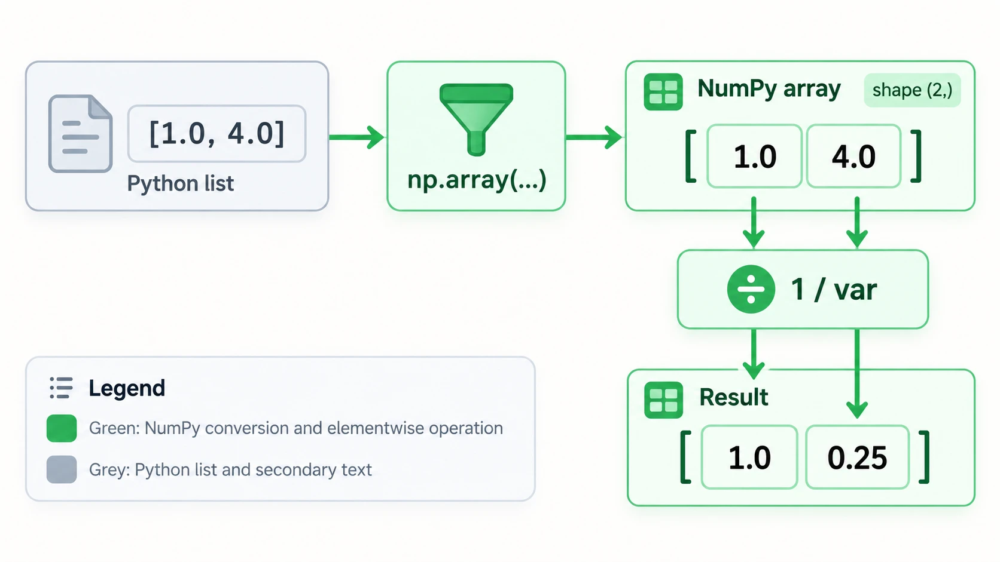
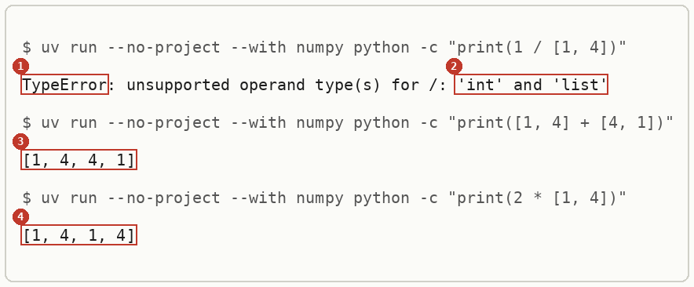
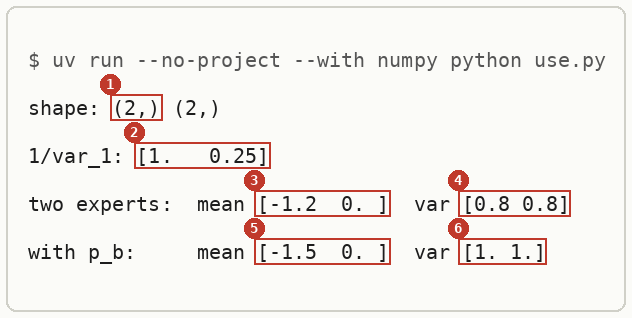
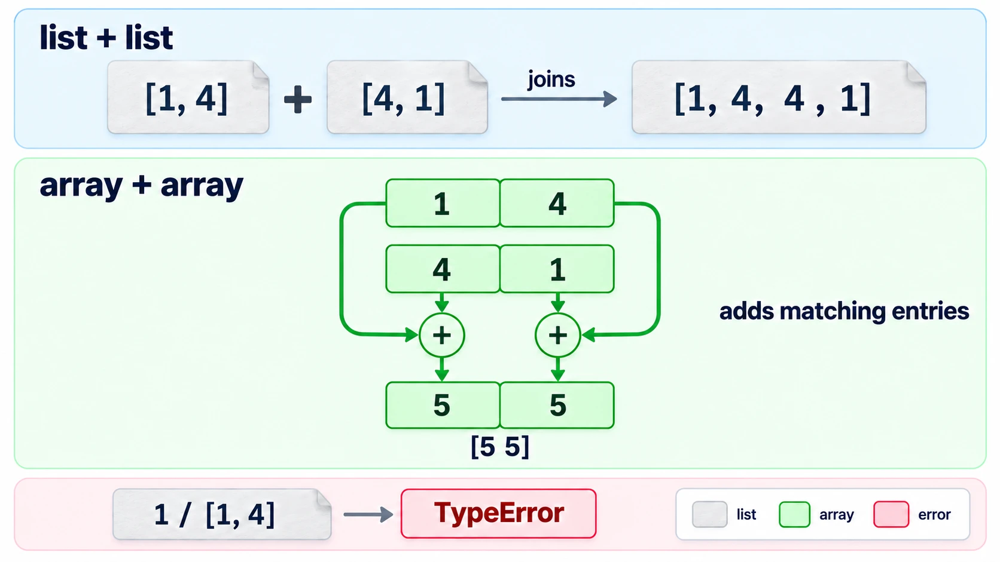
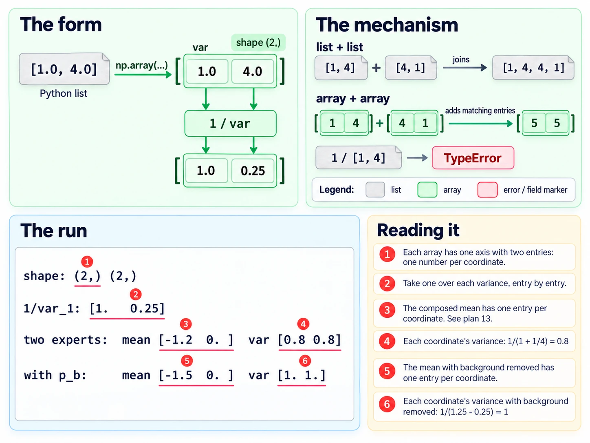

# Arrays Versus Python Lists

Up: [[NumPy]] · [[Broadcasting]] ➡️

Software, Python, NumPy. Needs: [[Modules And Imports]] for how a second file gets at the arrays you define.

> [!question] Test yourself
> [The NumPy quiz](https://claude.ai/artifact/Lh1wvXBiirkRyDvn76yZKR) covers this note, with the rest of the [[NumPy]] folder. Your attempts are saved on the page.

> [!warning] Unfinished
> - Two pictures are being redrawn: the mechanism fed both array cells into the plus signs from the whole block, so no entry could be followed into its own sum, and the deep-dive sheet's output and field cards were too small to read at note width. The current pictures stay until the new ones land. Their prompts are in the vault's `.prompts/NumPy.md`.
>
> Stated, not checked: 1 claim, marked where it sits.

**Wrap numbers in `np.array` before doing arithmetic on them, because a Python list treats `+` as joining and refuses `/` altogether.** A list `[1, 4]` written in a NumPy file is still a list. Importing NumPy changes nothing until you call `np.array`.

## Where you work

The setup is in [[NumPy#Where you work]].

## Table of contents

- [[#When to reach for it]]
- [[#The form]]
- [[#np.array]]
- [[#Try it yourself]]
- [[#Reading the output]]
- [[#How it works]]
- [[#Other ways]]
- [[#Why this matters]]
- [[#Taught in, applied in]]

## When to reach for it

Navigation: 📋 [[#Table of contents|TOC]] | [[#The form]] ➡️

Any time a formula acts on every coordinate at once: one over a variance, a mean divided by a variance, a sum across experts. Without arrays, division fails with a `TypeError`, and addition does something worse: it succeeds and returns a longer list.

## The form

Navigation: ⬅️ [[#When to reach for it]] | 📋 [[#Table of contents|TOC]] | [[#np.array]] ➡️

```text
np.array(<list of numbers>)              an array of shape (n,), its type read from the numbers
np.array(<list of numbers>, dtype=float) the same, forced to floating point
<array> + <array>                        added coordinate by coordinate, shapes must match
<number> / <array>                       the number divided by each coordinate
```



*The form, with the list going in, the shape `(2,)` and the arithmetic acting per coordinate.*
## np.array

Navigation: ⬅️ [[#The form]] | 📋 [[#Table of contents|TOC]] | [[#Try it yourself]] ➡️

**`np.array` turns a list of numbers into an array whose arithmetic acts on each number.** Written `np.array([1.0, 4.0])`, it holds two floats and has shape `(2,)`. Write the numbers with a decimal point (`4.0`, not `4`), so a later division never surprises you with an integer type. NumPy's `/` returns floats even on integer arrays, as step 5's third line shows, so this is a habit for readability rather than a fix.

## Try it yourself

Navigation: ⬅️ [[#np.array]] | 📋 [[#Table of contents|TOC]] | [[#Reading the output]] ➡️

**1. Make something to act on.** In the sandbox folder, save this as `toy.py`. It stores three two-dimensional Gaussians as (mean, variance) pairs, the [[Diagonal Covariance#Diagonal Gaussian|diagonal Gaussian]] form, using plain lists:

```python
import numpy as np 

if __name__ == "__main__":
    mu_b, var_b = ([0,0],[4,4])    
    mu_1, var_1 = ([-2,0],[1,4])    
    mu_2, var_2 = ([2,0],[4,1])    
    mu2s = [0,2]
    shared = [(mu_b, var_b), (mu_1, var_1), (mu_2, var_2)]
    split = [(mu_b, var_b), (mu_1, var_1), (mu2s, var_2)]
    print(f"shared: {shared}")
    print(f"split: {split}")
```

**2. Look at it before.**

```bash
uv run --no-project --with numpy python toy.py
```

You should see:

```text
shared: [([0, 0], [4, 4]), ([-2, 0], [1, 4]), ([2, 0], [4, 1])]
split: [([0, 0], [4, 4]), ([-2, 0], [1, 4]), ([0, 2], [4, 1])]
```

The values are right. Nothing in this output says they are lists rather than arrays, which is why the problem hides until the arithmetic.

**3. The failure without arrays.** Do the three operations the next step needs, on plain lists:

```bash
uv run --no-project --with numpy python -c "print(1 / [1, 4])"
uv run --no-project --with numpy python -c "print([1, 4] + [4, 1])"
uv run --no-project --with numpy python -c "print(2 * [1, 4])"
```

You should see the last line of an error, then two lists:



**4. The technique.** Rewrite `toy.py` with every list wrapped in `np.array`, the names above the `if` line so another file can import them (why is in [[Modules And Imports#Names defined under __main__]]):

```python
import numpy as np

mu_b, var_b = np.array([0.0, 0.0]), np.array([4.0, 4.0])
mu_1, var_1 = np.array([-2.0, 0.0]), np.array([1.0, 4.0])
mu_2, var_2 = np.array([2.0, 0.0]), np.array([4.0, 1.0])
mu_2s = np.array([0.0, 2.0])
shared = [(mu_b, var_b), (mu_1, var_1), (mu_2, var_2)]
split = [(mu_b, var_b), (mu_1, var_1), (mu_2s, var_2)]

if __name__ == "__main__":
    print(f"shared: {shared}")
    print(f"split: {split}")
```

Then save this as `use.py`. It multiplies the two experts' Gaussians, which for diagonal Gaussians means adding one-over-variance coordinate by coordinate, and then divides out the background:

```python
from toy import shared

(mu_b, var_b), (mu_1, var_1), (mu_2, var_2) = shared
print("shape:", mu_1.shape, var_1.shape)
print("1/var_1:", 1 / var_1)
prec = 1 / var_1 + 1 / var_2
var = 1 / prec
mu = var * (mu_1 / var_1 + mu_2 / var_2)
print("two experts:  mean", mu, " var", var)
prec3 = 1 / var_1 + 1 / var_2 - 1 / var_b
var3 = 1 / prec3
mu3 = var3 * (mu_1 / var_1 + mu_2 / var_2 - mu_b / var_b)
print("with p_b:     mean", mu3, " var", var3)
```

```bash
uv run --no-project --with numpy python use.py
```

You should see:



**5. Another way to get the same answer.** `np.asarray` does the same wrapping and skips the copy when its input is already an array:

```bash
uv run --no-project --with numpy python -c "import numpy as np; print(np.asarray([1, 4]) + np.asarray([4, 1])); print(np.array([1, 4]).dtype, np.array([1.0, 4.0]).dtype); print(1 / np.array([1, 4]))"
```

```text
[5 5]
int64 float64
[1.   0.25]
```

The first line is the `+` that joined the lists in step 3, now adding. The second shows the type each spelling gets. The third shows integer arrays still divide to floats.

**6. Clean up, and prove it.**

```bash
cd ~ && rm -r ~/playground/sandbox/numpy-arrays
ls ~/playground/sandbox/numpy-arrays; echo $?
```

You should see `No such file or directory`, then `2`.

## Reading the output

Navigation: ⬅️ [[#Try it yourself]] | 📋 [[#Table of contents|TOC]] | [[#How it works]] ➡️

The lists, from step 3:

| # | Field | This run | How to read it | Backing |
|---|---|---|---|---|
| 1 | error class | `TypeError` | Python has no rule for this operator on these two types | shown |
| 2 | operand types | `'int' and 'list'` | the left side is the number 1, the right side the list; a list has no `/` | shown |
| 3 | `[1, 4] + [4, 1]` | `[1, 4, 4, 1]` | `+` on lists joins them end to end, so a precision sum silently becomes a length-4 list | shown |
| 4 | `2 * [1, 4]` | `[1, 4, 1, 4]` | `*` by a whole number repeats the list | shown |

The arrays, from step 4:

| # | Field | This run | How to read it | Backing |
|---|---|---|---|---|
| 1 | shape | `(2,)` | one axis with two entries: one number per coordinate | shown |
| 2 | `1/var_1` | `[1.   0.25]` | one over each variance, 1/1 and 1/4; NumPy pads the columns to line up | shown |
| 3 | two experts, mean | `[-1.2  0. ]` | the composed mean; matches plan 13's (-1.2, 0) | shown |
| 4 | two experts, var | `[0.8 0.8]` | 1/(1/1 + 1/4) = 0.8 and 1/(1/4 + 1/1) = 0.8 | derived below |
| 5 | with background, mean | `[-1.5  0. ]` | the mean once the background's 1/4 is taken away; matches plan 13's (-1.5, 0) | shown |
| 6 | with background, var | `[1. 1.]` | 1/(1.25 - 0.25) = 1 on each coordinate | derived below |

## How it works

Navigation: ⬅️ [[#Reading the output]] | 📋 [[#Table of contents|TOC]] | [[#Other ways]] ➡️

The numbers in step 4 follow from adding precisions, one coordinate at a time.

$$
\begin{aligned}
\tfrac{1}{\sigma^2} &= \tfrac{1}{\sigma_1^2} + \tfrac{1}{\sigma_2^2} \\
\text{coordinate 1: } &= \tfrac{1}{1} + \tfrac{1}{4} = 1.25, \quad \sigma^2 = 0.8 \\
\text{coordinate 2: } &= \tfrac{1}{4} + \tfrac{1}{1} = 1.25, \quad \sigma^2 = 0.8 \\
\mu^{(1)} &= \sigma^2 \left( \tfrac{-2}{1} + \tfrac{2}{4} \right) = 0.8 \times (-1.5) = -1.2
\end{aligned}
$$

With the background divided out, the precision on each coordinate is $1.25 - 0.25 = 1$, so $\sigma^2 = 1$ and $\mu^{(1)} = 1 \times (-2 + 0.5 - 0) = -1.5$.

The mechanism behind the arrays, in three steps:

1. `np.array([1.0, 4.0])` stores two floats in one block with shape `(2,)`. Step 4's first line shows the shape.
2. An operator between an array and a number, or two arrays of the same shape, runs once per entry. Step 4's `1/var_1` shows it.
3. A list has its own operators: `+` joins and `*` repeats, and there is no `/`. Step 3 shows all three.



*The mechanism, a list joining end to end beside an array adding entry by entry.*


*The deep-dive sheet composing the form, the mechanism and the run.*
## Other ways

Navigation: ⬅️ [[#How it works]] | 📋 [[#Table of contents|TOC]] | [[#Why this matters]] ➡️

- `np.asarray(x)` when `x` may already be an array and you want no copy.
- `np.array(x, dtype=float)` when the numbers come in as whole numbers and you want floats from the start.
- A list comprehension, `[1 / v for v in var_1]`, works for one line of arithmetic and stops being readable by the second.
- JAX's `jnp.array` behaves the same way for this arithmetic. *Stated.*

## Why this matters

Navigation: ⬅️ [[#Other ways]] | 📋 [[#Table of contents|TOC]] | [[#Taught in, applied in]] ➡️

Every Gaussian formula with a diagonal covariance is per-coordinate arithmetic. A list silently turns the precision sum into a longer list, and the error appears two lines later, somewhere that looks unrelated.

## Taught in, applied in

Navigation: ⬅️ [[#Why this matters]] | 📋 [[#Table of contents|TOC]]

**Taught in:**

- the `drip-read` walk of [the Mechanisms of Projective Composition paper note](../../../deep-learning/01-poe-derivation-foundations/papers/mechanisms-of-projective-composition), step 1 of 3 up to the object, where the learner's lists matched the answer key and were then wrapped in `np.array`
- the PoE derivation foundations journey's plan 13, `plans/13-poe-on-two-gaussians.md`, lines 147 to 153 and 173 to 175, which compute these same composed means and variances

**Applied in:** nothing yet.

**Before this note:** the learner's LibreOffice note `Software/Python/Libraries/Numpy/Numpy.odt` covers `hstack`, `meshgrid` and `linspace`, not lists against arrays.

> [!note]- How this was checked
> Every output in this note was run by the writer in an empty folder, `~/playground/sandbox/numpy-arrays`, on the PC: Ubuntu under WSL2, Python 3.12.3, NumPy 2.4.6 through uv 0.8.13, on 2026-10-04. The folder was removed afterwards and the check in step 6 returned 2.
