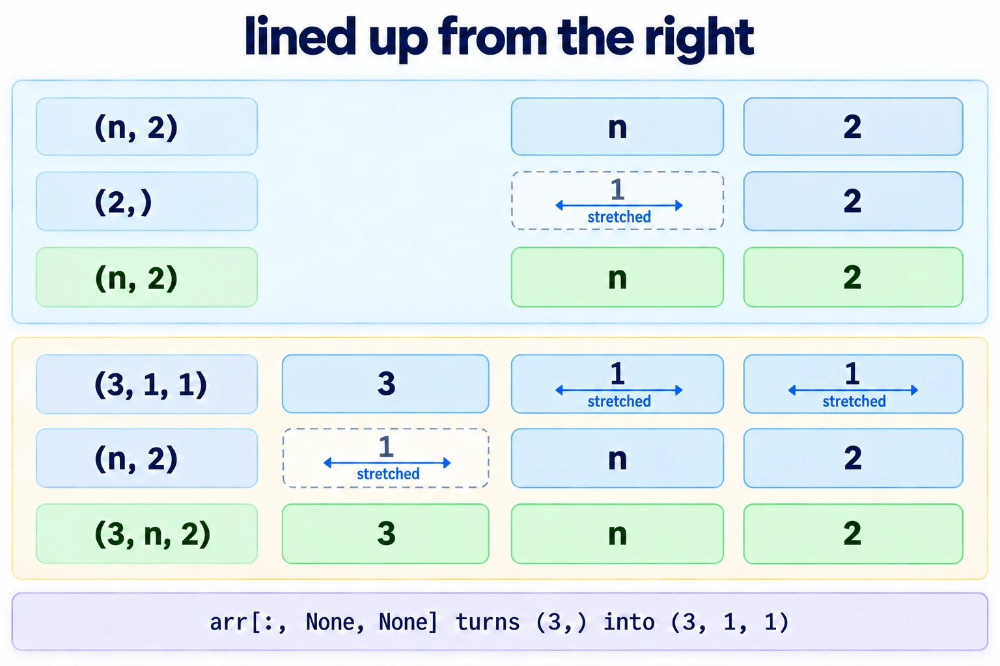
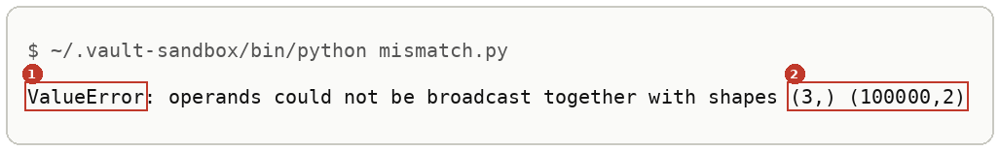
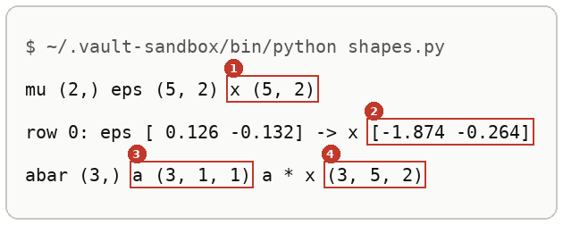
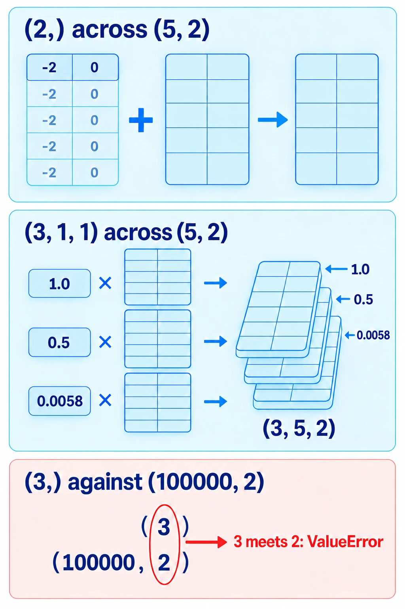
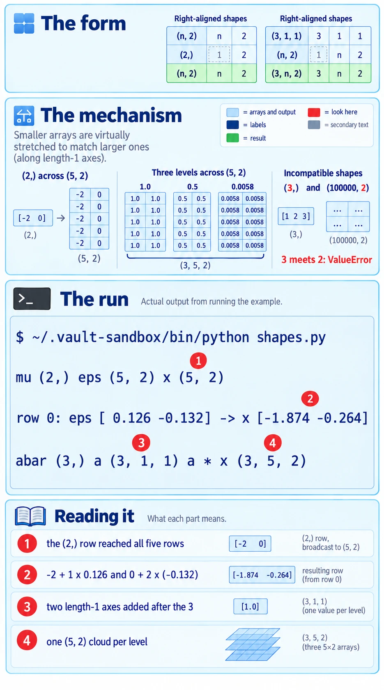

# Broadcasting

Up: [[NumPy]] · ⬅️ [[Arrays Versus Python Lists]] · [[Random Numbers From A Seeded Generator]] ➡️

Software, Python, NumPy. Needs: [[Arrays Versus Python Lists]].

> [!question] Test yourself
> [The NumPy quiz](https://claude.ai/artifact/Lh1wvXBiirkRyDvn76yZKR) covers this note, with the rest of the [[NumPy]] folder. Your attempts are saved on the page.

> [!warning] Unfinished
> - Three pictures are still to be drawn: the form, the mechanism and the deep-dive sheet. Their prompts are in the vault's `.prompts/NumPy.md`.
>
> Stated, not checked: 1 claim, marked where it sits.

**Broadcasting lets a smaller array act on a bigger one with no loop: a `(2,)` array is reused for every row of an `(n, 2)` matrix, and a `(3, 1, 1)` array applies each of its three numbers to the whole `(n, 2)` matrix, giving `(3, n, 2)`.** NumPy lines the two shapes up from the right. Each pair of lengths must be equal, or one of them must be 1, and a missing length counts as 1.

## Where you work

The setup is in [[NumPy#Where you work]].

## Table of contents

- [[#When to reach for broadcasting]]
- [[#The form of a broadcast]]
- [[#Try broadcasting yourself]]
- [[#Reading the broadcast output]]
- [[#How broadcasting works]]
- [[#Other ways to broadcast]]
- [[#Why broadcasting matters]]
- [[#Broadcasting taught in, applied in]]

## When to reach for broadcasting

Navigation: 📋 [[#Table of contents|TOC]] | [[#The form of a broadcast]] ➡️

When one small set of numbers applies to every row of a big array: a mean and a standard deviation applied to $n$ random points, as in [[Sampling A Diagonal Gaussian]], or several noise levels applied to one whole cloud, as in [[The Forward Process]]. Without it you write a loop over rows or levels. When the shapes do not line up, NumPy stops with a `ValueError` that names both shapes, and the fix is to give the small array length-1 axes in the right places.

## The form of a broadcast

Navigation: ⬅️ [[#When to reach for broadcasting]] | 📋 [[#Table of contents|TOC]] | [[#Try broadcasting yourself]] ➡️

```text
(n, 2) <op> (2,)         -> (n, 2)      the (2,) row is reused for each of the n rows
(3, 1, 1) <op> (n, 2)    -> (3, n, 2)   each of the 3 numbers multiplies the whole (n, 2) matrix
<arr>[:, None, None]                    a (3,) array seen as (3, 1, 1): two new axes of length 1
```

`None` inside the brackets is NumPy's `np.newaxis`: it adds an axis of length 1 at that place.



*The form, two shapes written one above the other and lined up from the right, with the length-1 axes stretching.*

## Try broadcasting yourself

Navigation: ⬅️ [[#The form of a broadcast]] | 📋 [[#Table of contents|TOC]] | [[#Reading the broadcast output]] ➡️

**1. What you need, and when it is missing.** Python with NumPy. The commands below use the prepared environment `~/.vault-sandbox/bin/python`; [[Sampling A Diagonal Gaussian#Try sampling yourself]] steps 1 and 2 say how to check it and what to do when it is missing.

**2. Make something to act on.**

```bash
mkdir -p ~/playground/sandbox/gaussian-clouds && cd ~/playground/sandbox/gaussian-clouds
```

**3. The failure: three noise levels against a cloud, with no length-1 axes.** Save this as `mismatch.py`:

```python
import numpy as np

abar = np.array([1.0, 0.5, 0.0058])
x0 = np.zeros((100_000, 2))
xt = np.sqrt(abar) * x0
```

```bash
~/.vault-sandbox/bin/python mismatch.py
```

You should see the last line of an error:



Lined up from the right, the `3` of `abar` meets the `2` of `x0`. They differ and neither is 1, so NumPy stops.

**4. The technique.** Save this as `shapes.py`. It applies a `(2,)` mean and standard deviation to five random points, then three noise levels to the result:

```python
import numpy as np

rng = np.random.default_rng(0)
mu, var = np.array([-2.0, 0.0]), np.array([1.0, 4.0])
eps = rng.standard_normal((5, 2))
x = mu + np.sqrt(var) * eps
print("mu", mu.shape, "eps", eps.shape, "x", x.shape)
print("row 0: eps", eps[0].round(3), "-> x", x[0].round(3))

abar = np.array([1.0, 0.5, 0.0058])
a = abar[:, None, None]
print("abar", abar.shape, "a", a.shape, "a * x", (a * x).shape)
```

```bash
~/.vault-sandbox/bin/python shapes.py
```

You should see:



**5. Other ways to get the same answer.** `reshape(3, 1, 1)` and `np.newaxis` give the same `(3, 1, 1)`, and a loop stacked into one array gives the same result shape:

```bash
~/.vault-sandbox/bin/python -c "import numpy as np; abar = np.array([1.0, 0.5, 0.0058]); x0 = np.ones((100_000, 2)); print(np.stack([np.sqrt(a) * x0 for a in abar]).shape, (np.sqrt(abar.reshape(3, 1, 1)) * x0).shape, (np.sqrt(abar[:, np.newaxis, np.newaxis]) * x0).shape)"
```

```text
(3, 100000, 2) (3, 100000, 2) (3, 100000, 2)
```

**6. Clean up, and prove it.**

```bash
cd ~ && rm -r ~/playground/sandbox/gaussian-clouds
ls ~/playground/sandbox/gaussian-clouds; echo $?
```

You should see `No such file or directory`, then `2`.

## Reading the broadcast output

Navigation: ⬅️ [[#Try broadcasting yourself]] | 📋 [[#Table of contents|TOC]] | [[#How broadcasting works]] ➡️

From step 4:

| # | Field | This run | How to read it | Backing |
|---|---|---|---|---|
| 1 | `x` shape | `(5, 2)` | the `(2,)` mean and standard deviation reached all five rows | shown |
| 2 | row 0 of `x` | `[-1.874 -0.264]` | row 0 of `eps`, `[0.126 -0.132]`, shifted by `mu` and stretched by `[1, 2]` | derived below |
| 3 | `a` shape | `(3, 1, 1)` | `abar` with two length-1 axes added after its 3 | shown |
| 4 | `a * x` shape | `(3, 5, 2)` | one `(5, 2)` cloud per noise level | derived below |

From step 3, the error names the two shapes it could not line up, `(3,)` and `(100000,2)`, in the order they appeared in the expression.

## How broadcasting works

Navigation: ⬅️ [[#Reading the broadcast output]] | 📋 [[#Table of contents|TOC]] | [[#Other ways to broadcast]] ➡️

Textbook: [Deep learning textbook, section 2.1, p. 50](../../../Mathematics/references/textbooks/machine-learning/deep-learning-textbook.pdf#page=50)

Write the shapes one above the other, aligned on the right, and fill missing places with 1:

```text
x0:            100000   2         ->   (1, 100000, 2)
a:          3       1   1         ->   (3,      1, 1)
result:     3  100000   2
```

In each column the lengths are equal, or one of them is 1 and is stretched to the other. In step 3, `abar` had shape `(3,)`, so its 3 sat under the 2 and the rule failed. *Cited:* the NumPy broadcasting page in the sources.

The worked numbers for row 0 of step 4, with $\sqrt{\text{var}} = (1, 2)$:

$$
\begin{aligned}
x^{(1)} &= -2 + 1 \times 0.126 = -1.874 \\
x^{(2)} &= 0 + 2 \times (-0.132) = -0.264
\end{aligned}
$$



*The mechanism, the `(2,)` row copied down five rows, and the `(3, 1, 1)` column copied across a whole cloud three times.*



*The deep-dive sheet composing the form, the mechanism and the run.*

## Other ways to broadcast

Navigation: ⬅️ [[#How broadcasting works]] | 📋 [[#Table of contents|TOC]] | [[#Why broadcasting matters]] ➡️

- `arr.reshape(3, 1, 1)`, when the new shape is easier to read written out in full.
- `arr[:, np.newaxis, np.newaxis]`, the spelled-out name for `None`.
- A loop over levels with `np.stack`, when each level needs different code. It gives the same result shape and is slower for many levels. *Stated:* the speed was not timed here.

## Why broadcasting matters

Navigation: ⬅️ [[#Other ways to broadcast]] | 📋 [[#Table of contents|TOC]] | [[#Broadcasting taught in, applied in]] ➡️

The diffusion forward process noises a whole cloud at several levels in one line, and sampling stretches every point in one line. Both lines rely on shapes lining up from the right, and the `ValueError` of step 3 is what you see when they do not.

## Broadcasting taught in, applied in

Navigation: ⬅️ [[#Why broadcasting matters]] | 📋 [[#Table of contents|TOC]]

**Taught in:**

- the `drip-read` walk of [the Mechanisms of Projective Composition paper note](../../../deep-learning/01-poe-derivation-foundations/papers/mechanisms-of-projective-composition), step 2, where `mu` of shape `(2,)` broadcast across the `(n, 2)` matrix of draws, and step 3c, where `abar` reshaped to `(3, 1, 1)` made a `(3, 100000, 2)` tensor

**Applied in:** nothing yet.

> [!note]- How this was checked
> Every output in this note and [[Random Numbers From A Seeded Generator]] was run by the writer in an empty folder, `~/playground/sandbox/gaussian-clouds`, on the PC: Ubuntu under WSL2, through the prepared environment `~/.vault-sandbox/bin/python` (Python 3.11.13, NumPy 2.4.6), on 2026-10-04. `stream.py` was run twice and printed identical output both times; `np.random.seed(0)` was run twice and printed `[1.7641 0.4002 0.9787]` both times. The folder was removed afterwards and the clean-up check returned 2.
