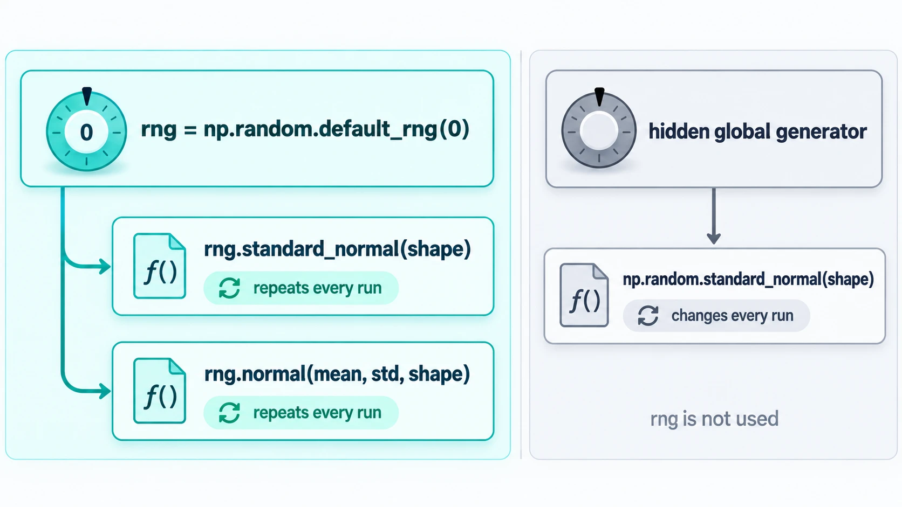
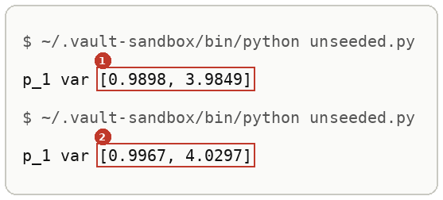
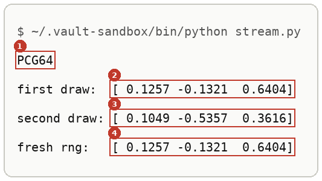
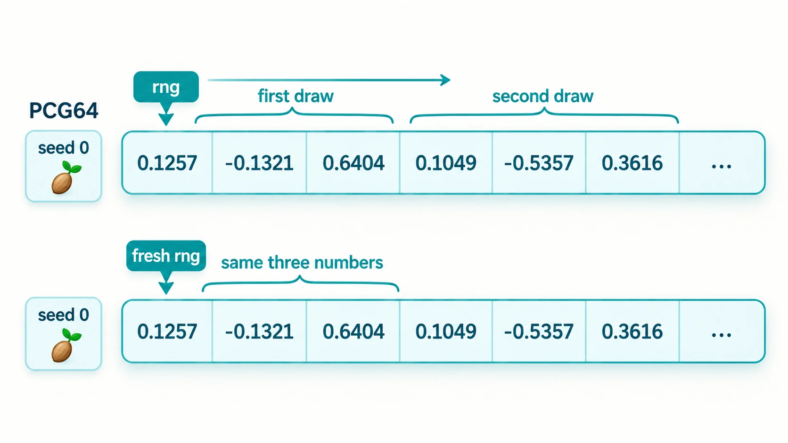
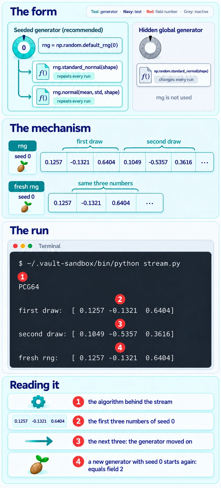

# Random Numbers From A Seeded Generator

Up: [[NumPy]] · ⬅️ [[Broadcasting]]

Software, Python, NumPy. Needs: [[Arrays Versus Python Lists]].

> [!question] Test yourself
> [The NumPy quiz](https://claude.ai/artifact/Lh1wvXBiirkRyDvn76yZKR) covers this note, with the rest of the [[NumPy]] folder. Your attempts are saved on the page.

> [!warning] Unfinished
> - Three pictures are still to be drawn: the form, the mechanism and the deep-dive sheet. Their prompts are in the vault's `.prompts/NumPy.md`.

**Make one generator with `rng = np.random.default_rng(seed)` and draw every random number from it, so the same seed prints the same numbers on every run.** The functions directly under `np.random`, such as `np.random.standard_normal`, draw from a separate global generator that your `rng` never touches. Seeding `rng` and then calling one of them gives numbers that change on every run.

## Where you work

The setup is in [[NumPy#Where you work]].

## Table of contents

- [[#np.random.default_rng]]
- [[#When to reach for a seeded generator]]
- [[#The form of a seeded draw]]
- [[#Try seeding yourself]]
- [[#Reading the seeded output]]
- [[#How seeding works]]
- [[#Other ways to seed]]
- [[#Why seeding matters]]
- [[#Seeding taught in, applied in]]

## np.random.default_rng

Navigation: 📋 [[#Table of contents|TOC]] | [[#When to reach for a seeded generator]] ➡️

**`np.random.default_rng(seed)` returns a `Generator`, NumPy's current random-number object, set to a starting state by `seed`.** Its methods (`standard_normal`, `normal`, `uniform` and the rest) each move it along one stream of numbers. Two generators made with the same seed give the same stream. *Cited:* the NumPy random Generator page in the sources.

## When to reach for a seeded generator

Navigation: ⬅️ [[#np.random.default_rng]] | 📋 [[#Table of contents|TOC]] | [[#The form of a seeded draw]] ➡️

Whenever a printed number will be compared with something: an answer key, a run from yesterday, a check that should fail when the code is wrong. Without a fixed seed, every run prints slightly different numbers, and a real change cannot be told from noise.

## The form of a seeded draw

Navigation: ⬅️ [[#When to reach for a seeded generator]] | 📋 [[#Table of contents|TOC]] | [[#Try seeding yourself]] ➡️

```text
rng = np.random.default_rng(<seed>)     made once, near the top of the file
rng.standard_normal(<shape>)            draws from rng's stream
rng.normal(<mean>, <std>, <shape>)      the same stream, shifted and scaled
np.random.standard_normal(<shape>)      draws from the hidden global generator; rng is not used
```



*The form, one seeded generator feeding every draw in a file, beside the hidden global generator that a bare `np.random` call uses.*

## Try seeding yourself

Navigation: ⬅️ [[#The form of a seeded draw]] | 📋 [[#Table of contents|TOC]] | [[#Reading the seeded output]] ➡️

**1. What you need, and when it is missing.** As in [[Broadcasting#Try broadcasting yourself]] step 1.

**2. Make something to act on.** In `~/playground/sandbox/gaussian-clouds`, save the learner's `toy.py` from [[Sampling A Diagonal Gaussian#Try sampling yourself]] step 3.

**3. The failure: a seeded `rng` that is never used.** Save this as `unseeded.py`. It makes `rng` and then draws from `np.random`, the walk's step 2 slip:

```python
import numpy as np
from toy import shared

rng = np.random.default_rng(0)

def sample(mu, var, n):
    return mu + np.sqrt(var) * np.random.standard_normal((n, len(mu)))

mu, var = shared[1]
x = sample(mu, var, 100_000)
print("p_1 var", np.round(x.var(0), 4).tolist())
```

Run it twice:

```bash
~/.vault-sandbox/bin/python unseeded.py
~/.vault-sandbox/bin/python unseeded.py
```

You should see two different lines:



Your numbers will differ from these and from each other. That is the failure.

**4. The technique.** Save this as `stream.py`:

```python
import numpy as np

rng = np.random.default_rng(0)
print(type(rng.bit_generator).__name__)
print("first draw: ", rng.standard_normal(3).round(4))
print("second draw:", rng.standard_normal(3).round(4))

fresh = np.random.default_rng(0)
print("fresh rng:  ", fresh.standard_normal(3).round(4))
```

```bash
~/.vault-sandbox/bin/python stream.py
```

You should see:



Run it again and the same four lines come back. The first two, `0.1257` and `-0.1321`, are row 0 of `eps` in [[Broadcasting#Try broadcasting yourself]] step 4, because that file also drew first from `default_rng(0)`.

**5. Another way to get the same answer.** The older global seed, `np.random.seed`, also makes runs repeat:

```bash
~/.vault-sandbox/bin/python -c "import numpy as np; np.random.seed(0); print(np.random.standard_normal(3).round(4))"
```

```text
[1.7641 0.4002 0.9787]
```

Run twice, it prints the same line. Its stream differs from `default_rng(0)`'s, and it seeds one generator shared by every module in the program, so a library that also draws from it moves your numbers. NumPy's documentation calls it legacy. *Cited:* the NumPy legacy random page in the sources.

**6. Clean up, and prove it.**

```bash
cd ~ && rm -r ~/playground/sandbox/gaussian-clouds
ls ~/playground/sandbox/gaussian-clouds; echo $?
```

You should see `No such file or directory`, then `2`.

## Reading the seeded output

Navigation: ⬅️ [[#Try seeding yourself]] | 📋 [[#Table of contents|TOC]] | [[#How seeding works]] ➡️

From step 4:

| # | Field | This run | How to read it | Backing |
|---|---|---|---|---|
| 1 | bit generator | `PCG64` | the algorithm that produces the stream: `default_rng` picks PCG64 | shown |
| 2 | first draw | `[ 0.1257 -0.1321  0.6404]` | the first three standard-normal numbers of seed 0's stream | shown |
| 3 | second draw | `[ 0.1049 -0.5357  0.3616]` | the next three: the generator moved on, so the draws differ | shown |
| 4 | fresh rng | `[ 0.1257 -0.1321  0.6404]` | a new generator with seed 0 starts the stream again: equal to field 2 | shown |

From step 3, the two variance lines differ in the second or third decimal place. Both are within sampling error of `[1, 4]`, which is why the slip is easy to miss: every number looks plausible, and none repeats.

## How seeding works

Navigation: ⬅️ [[#Reading the seeded output]] | 📋 [[#Table of contents|TOC]] | [[#Other ways to seed]] ➡️

Nothing here follows from numbers. The mechanism takes four steps, each shown above.

1. `np.random.default_rng(0)` builds a PCG64 generator whose internal state is set from the seed 0. Step 4's first line names it.
2. Each call such as `rng.standard_normal(3)` reads the next numbers from that state and moves it forward. Step 4's second and third lines differ.
3. A second generator built from the same seed starts from the same state. Step 4's last line repeats the first draw.
4. `np.random.standard_normal` reads from a separate global generator, seeded unpredictably when NumPy loads unless `np.random.seed` is called. Step 3's two runs differ even though `rng` was seeded. *Cited:* the NumPy legacy random page in the sources.



*The mechanism, the seed setting a state, each draw reading the next numbers and moving the state on, and a second generator replaying the stream.*



*The deep-dive sheet composing the form, the mechanism and the run.*

## Other ways to seed

Navigation: ⬅️ [[#How seeding works]] | 📋 [[#Table of contents|TOC]] | [[#Why seeding matters]] ➡️

- `np.random.seed(0)` with the `np.random` functions, in older code. It repeats, as step 5 shows, and every library in the program shares it.
- Passing a generator into a function, `def sample(mu, var, n, rng):`, when several files must draw from one stream. The walk's `noised.py` imports `rng` from `samples.py` for the same reason.
- `random_state=0` on SciPy's `rvs` methods, which seeds SciPy's draw; see [[Sampling A Diagonal Gaussian#Try sampling yourself]] step 6.

## Why seeding matters

Navigation: ⬅️ [[#Other ways to seed]] | 📋 [[#Table of contents|TOC]] | [[#Seeding taught in, applied in]] ➡️

A walk's answer key is a run at seed 0. A learner's file that draws from the unseeded global generator can never match it digit for digit, so every comparison becomes "close enough", and a real mistake hides inside the noise.

## Seeding taught in, applied in

Navigation: ⬅️ [[#Why seeding matters]] | 📋 [[#Table of contents|TOC]]

**Taught in:**

- the `drip-read` walk of [the Mechanisms of Projective Composition paper note](../../../deep-learning/01-poe-derivation-foundations/papers/mechanisms-of-projective-composition), step 2, where the learner's `samples.py` made `rng = np.random.default_rng(0)` and drew from `np.random.standard_normal`, and the walk's correction was to draw from `rng`

**Applied in:** nothing yet.

> [!note]- How this was checked
> Every output in [[Broadcasting]] and this note was run by the writer in an empty folder, `~/playground/sandbox/gaussian-clouds`, on the PC: Ubuntu under WSL2, through the prepared environment `~/.vault-sandbox/bin/python` (Python 3.11.13, NumPy 2.4.6), on 2026-10-04. `stream.py` was run twice and printed identical output both times; `np.random.seed(0)` was run twice and printed `[1.7641 0.4002 0.9787]` both times. The folder was removed afterwards and the clean-up check returned 2.
